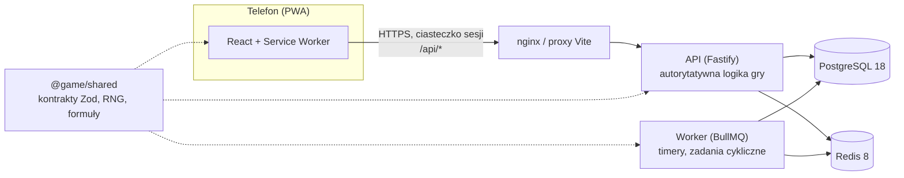

# Zapomniany Brzeg

Mobilna gra webowa (PWA) typu PvE RPG w mrocznym, lovecraftowskim klimacie, wzorowana mechanicznie na Isekai Guardians. Projekt gry opisuje dokument projektowy (GDD).

To repozytorium zawiera **fundament techniczny**: monorepo, klienta PWA, autorytatywny serwer API, bazę z migracjami, kolejkę zadań, logowanie i szkielet interfejsu. Systemów gry (walka, zlecenia, Seanse…) jeszcze tu nie ma — powstaną etapami według GDD.

## Stos technologiczny i uzasadnienie

| Warstwa          | Wybór                                                                                  | Dlaczego                                                                                                                                                                                                                                                                                          |
| ---------------- | -------------------------------------------------------------------------------------- | ------------------------------------------------------------------------------------------------------------------------------------------------------------------------------------------------------------------------------------------------------------------------------------------------- |
| Monorepo         | **pnpm 12** (workspaces) + **Turborepo 2.11**                                          | Ścisła izolacja zależności (brak „fantomowych” importów), szybkie instalacje, cache zadań i graf zależności (`^build`), dzięki któremu pakiet współdzielony buduje się przed aplikacjami.                                                                                                         |
| Język            | **TypeScript 6.0** (strict, `exactOptionalPropertyTypes`, `noUncheckedIndexedAccess`)  | Jeden język i jedne typy od bazy po UI. TypeScript 7 (natywny kompilator) nie jest jeszcze wspierany przez typescript-eslint (wymaga `<6.1`), więc przejdziemy na niego, gdy pojawi się wsparcie.                                                                                                 |
| Klient           | **React 19** + **Vite 8** + **vite-plugin-pwa 2** (Workbox) + **Tailwind CSS 4**       | Gra to aplikacja za logowaniem — SEO i SSR nic nie dają, więc Next.js byłby zbędnym narzutem. Vite daje najszybszy build i najprostszą PWA (manifest, service worker, offline dla zasobów statycznych), a wynik to statyczne pliki do CDN.                                                        |
| Routing i dane   | **React Router 8** + **TanStack Query 5**                                              | Sprawdzony routing deklaratywny; TanStack Query zarządza stanem serwera (cache, ponawianie, odświeżanie po powrocie do karty), co pasuje do gry asynchronicznej.                                                                                                                                  |
| API              | **Fastify 5** + **Zod 4**                                                              | Szybki i lekki, bez ceremonii NestJS. Gotowe pluginy (cookie, helmet, rate-limit) i `inject()` do testów bez sieci. Zamiast tRPC wybraliśmy zwykłe REST + współdzielone schematy Zod: typy są end-to-end tak samo, a API zostaje standardowym HTTP (logi, cache, curl, przyszli klienci natywni). |
| Baza             | **PostgreSQL 18** + **Drizzle ORM 0.45** + drizzle-kit                                 | Transakcje, ograniczenia `CHECK`/`UNIQUE` i blokady wierszy są kluczowe dla księgi walut i anty-cheatu (GDD rozdz. 9). Drizzle jest „SQL-first”, bez silnika binarnego (w odróżnieniu od Prismy), a migracje to czytelne pliki SQL w repo. PostgreSQL 18 daje natywne `uuidv7()`.                 |
| Timery i kolejki | **Redis 8** + **BullMQ 6** (osobny proces workera)                                     | GDD opiera grę na timerach (`TimedActivity`) i zadaniach cyklicznych (rozdz. 9.3). Redis obsługuje też limit prób logowania.                                                                                                                                                                      |
| Czas rzeczywisty | **WebSocket — celowo jeszcze nie**                                                     | Rozgrywka jest asynchroniczna (timery + Web Push). Gdy dojdą czat, loże i rajdy na żywo: `@fastify/websocket` + Redis pub/sub w procesie API.                                                                                                                                                     |
| Uwierzytelnianie | E-mail + hasło, **Argon2id**, sesje w PostgreSQL, ciasteczko `httpOnly` `SameSite=Lax` | Sesje nieprzezroczyste (w bazie tylko skrót SHA-256 tokenu) można natychmiast unieważnić (wylogowanie, ban) — w przeciwieństwie do JWT. API i PWA dzielą origin (proxy), więc nie potrzeba CORS.                                                                                                  |
| Testy            | **Vitest 5**, Testing Library, **Playwright 1.64**                                     | Jednostkowe i integracyjne (prawdziwy PostgreSQL i Redis), E2E na emulowanych telefonach: Pixel 7 (Chromium) i iPhone 14 (WebKit; ekran 390×844, jak w definicji ukończenia GDD).                                                                                                                 |
| Jakość           | **ESLint 10** (typescript-eslint `strictTypeChecked`, react-hooks), **Prettier 3**, CI | Reguły z informacją o typach łapią błędy asynchroniczne i niebezpieczne `any`. GitHub Actions uruchamia wszystko przy każdym PR.                                                                                                                                                                  |
| Uruchomienie     | **Docker Compose**, Node.js **24 LTS**                                                 | Jedno polecenie stawia bazę i Redisa do developmentu albo pełny stos (API, worker, migracje, PWA za nginx).                                                                                                                                                                                       |

## Architektura



### Autorytatywny serwer

Zgodnie z GDD (rozdz. 9) **klient jest tylko oknem**:

- Klient wysyła **intencje** (np. „rozpocznij zlecenie”), nigdy wyników. Nagrody, walka, losowania i poziomy zmieniają się wyłącznie na serwerze, w transakcjach bazy.
- **Czas** pochodzi z zegara serwera (`Clock` w API, endpoint `GET /api/v1/time`). Logika nie woła `new Date()` bezpośrednio, więc testy używają wirtualnego zegara.
- **Losowanie**: serwer wybiera ziarno (CSPRNG) i rozstrzyga rzut deterministycznym generatorem z `@game/shared` (sfc32, wyłącznie arytmetyka 32-bitowa). Zapisane ziarno pozwala odtworzyć walkę lub łup (powtórki, audyt).
- **Formuły** (np. krzywa doświadczenia z GDD 10.2) są w `@game/shared` jako czyste funkcje. Serwer liczy nimi stan gry, klient — tylko podgląd (np. pasek XP). Wartości są zablokowane **wektorami referencyjnymi** (`GOLDEN_VECTORS`), które sprawdzają testy pakietu, serwera i klienta (przez potok Vite). Wersję balansu oznacza `BALANCE_VERSION`.

## Struktura repozytorium

```
apps/
  api/          serwer Fastify, schemat bazy (Drizzle), migracje SQL (drizzle/), worker BullMQ
  web/          klient PWA (React, Vite, Tailwind), ikony, konfiguracja nginx
packages/
  shared/       kontrakty API (Zod), balans, dane statyczne, deterministyczny RNG, krzywa XP
  content/      potok treści: paczki, migracje addytywne, publikacja, eventy
tools/
  balance/      symulacje Monte Carlo balansu (GDD 10.12)
e2e/            testy Playwright na widoku mobilnym
apps/panel/     Kancelaria — panel personelu (osobna aplikacja)
docker-compose.yml, turbo.json, eslint.config.js, .github/workflows/ci.yml
```

## Szybki start

Wymagania: **Node.js 24 LTS** (minimum 22.22), **corepack** (dostarcza pnpm w wersji z `package.json`) i **Docker**.

```bash
corepack enable
pnpm install
cp .env.example .env
docker compose up -d                  # PostgreSQL 18 + Redis 8
pnpm db:migrate                       # migracje bazy
pnpm dev                              # API na :3000, PWA na :5173 (proxy /api → API)
pnpm --filter @game/api dev:worker    # opcjonalnie: worker kolejki timerów
```

Otwórz <http://localhost:5173> (najlepiej w trybie urządzenia mobilnego w DevTools) i załóż konto.

Pełny stos w kontenerach (migracje, API, worker, PWA za nginx):

```bash
docker compose --profile app up --build   # → http://localhost:8080
```

## Polecenia

| Polecenie                       | Co robi                                                      |
| ------------------------------- | ------------------------------------------------------------ |
| `pnpm dev`                      | tryb deweloperski wszystkich pakietów (watch)                |
| `pnpm build`                    | build produkcyjny (shared → api, web)                        |
| `pnpm lint`                     | ESLint z regułami typowanymi                                 |
| `pnpm typecheck`                | kontrola typów wszystkich pakietów                           |
| `pnpm format` / `:check`        | Prettier                                                     |
| `pnpm test`                     | testy jednostkowe (shared, api, web)                         |
| `pnpm test:integration`         | testy integracyjne API na prawdziwym PostgreSQL i Redisie    |
| `pnpm test:e2e`                 | testy E2E Playwright (buduje i uruchamia API oraz PWA)       |
| `pnpm db:generate`              | generuje migrację SQL ze zmian w `apps/api/src/db/schema.ts` |
| `pnpm db:migrate`               | stosuje migracje                                             |
| `pnpm --filter @game/web icons` | odtwarza ikony PWA z `apps/web/public/favicon.svg`           |

## Testy

- **Jednostkowe** (`pnpm test`) — nie wymagają infrastruktury.
- **Integracyjne** (`pnpm test:integration`) — wymagają `docker compose up -d`. Używają osobnej bazy `game_test` (tworzonej automatycznie) i bazy Redis nr 1, więc nie dotykają danych deweloperskich. Adresy można nadpisać zmiennymi `TEST_DATABASE_URL` i `TEST_REDIS_URL`.
- **E2E** (`pnpm test:e2e`) — wymagają PostgreSQL i Redisa. Za pierwszym razem zainstaluj przeglądarki: `pnpm --filter @game/e2e exec playwright install chromium webkit`. Playwright uruchamia zbudowane API (port 3100, z migracjami), worker kolejki i `vite preview` (port 4173). API działa wtedy z `ENABLE_TEST_CONTROLS=true`: zegar serwera można przesunąć (`POST /api/test/clock/advance`), a rozstrzyganie timerów wywołać ręcznie (`POST /api/test/jobs/activities-sweep`). Konfiguracja odrzuca tę flagę na produkcji. Zegar jest wspólny, więc testy E2E idą po kolei.
- **Balans** (`pnpm --filter @game/balance simulate`) — symulacja Monte Carlo 600 dni gracza-bota (GDD 10.12) na tych samych funkcjach co serwer; testy pakietu `tools/balance` (część `pnpm test`) zgłaszają alarm przy odchyleniu > 15% od tabel GDD.

## API (v1)

| Metoda i ścieżka                         | Opis                                                     |
| ---------------------------------------- | -------------------------------------------------------- |
| `GET /api/health`                        | stan bazy i Redisa (200 albo 503)                        |
| `GET /api/v1/time`                       | czas serwera                                             |
| `POST /api/v1/auth/register`             | konto + postać (jedna na konto) + sesja                  |
| `POST /api/v1/auth/login`                | logowanie (limit prób na IP)                             |
| `POST /api/v1/auth/logout`               | unieważnienie sesji                                      |
| `GET /api/v1/me`                         | konto i postać zalogowanego gracza                       |
| `GET /api/v1/dashboard`                  | pulpit Dom: czas serwera, postać, zasoby, Srebro, timery |
| `POST /api/v1/activities` ¹              | start zlecenia (koszt Wigoru, ziarno, timer)             |
| `POST /api/v1/activities/:id/claim` ¹    | odbiór nagrody jednego zlecenia                          |
| `POST /api/v1/activities/claim-all` ¹    | odbiór wszystkich gotowych nagród                        |
| `GET /api/v1/push/config`                | czy Web Push działa + klucz publiczny VAPID              |
| `POST/DELETE /api/v1/push/subscriptions` | subskrypcja powiadomień urządzenia                       |

¹ Wymaga nagłówka `Idempotency-Key` (GDD 9.2). Powtórka z tym samym kluczem zwraca zapisaną odpowiedź z nagłówkiem `idempotent-replayed: true`; ten sam klucz z inną treścią to błąd 422.

Błędy mają postać `{ "error": { "code": "…", "message": "…" } }`; kody są w `ERROR_CODES` w `@game/shared`.

## Model danych

Zgodnie z GDD (rozdz. 8):

| Tabela                               | Rola                                                                                                          |
| ------------------------------------ | ------------------------------------------------------------------------------------------------------------- |
| `accounts`, `characters`, `sessions` | konto, jedna postać na konto (unikalne imię), sesje                                                           |
| `resource_states`                    | Życie, Wigor, Znój, Poczytalność z czasem ostatniej zmiany — leniwa regeneracja                               |
| `wallet_entries`                     | księga walut: każdy wpis ma `delta`, `balance_after` i klucz idempotencji; saldo nie jest nigdzie nadpisywane |
| `timed_activities`                   | jeden model wszystkich timerów: ziarno wyniku, `balance_version`, status `active → completed → claimed`       |
| `idempotency_keys`                   | odpowiedzi do powtórek żądań (sprzątane po dobie)                                                             |
| `audit_log`                          | rejestracja, logowanie, start i odbiór aktywności (z IP i urządzeniem)                                        |
| `push_subscriptions`                 | urządzenia gracza dla Web Push                                                                                |

Zmiany schematu: edytuj `apps/api/src/db/schema.ts`, uruchom `pnpm db:generate` i dołącz wygenerowany plik SQL do commita.

## Etap 0 (GDD 11) — jak działa

- **Balans** (`packages/shared/src/balance.ts`, `BALANCE_VERSION`): limity i regeneracja zasobów (10.1), czasy i koszty zleceń, nagrody XP (10.2) i Srebra (10.5), krzywa XP z GDD 1.1. Te same funkcje liczą stan na serwerze i podgląd w kliencie.
- **Leniwa regeneracja**: w bazie jest wartość z chwili ostatniej zmiany; bieżącą wartość liczy `materializeResource` z czasu serwera. Niepełny tik nie przepada, a pełny zasób zaczyna odliczanie dopiero od wydania.
- **Księga walut**: wpisy postaci serializuje blokada wiersza postaci, więc nie ma podwójnego wydania; nagroda za aktywność ma klucz `activity:<id>:reward`, więc nie wypłaci się dwa razy.
- **Timery i scheduler**: start zapisuje ziarno (CSPRNG) i `end_at`. Worker co minutę rozstrzyga zakończone timery (`SKIP LOCKED`, więc może działać wiele workerów) i kolejkuje powiadomienia. Codziennie o 00:00 UTC sprząta wygasłe sesje i klucze idempotencji. Pulpit rozstrzyga timery także od razu, gdy gracz wraca do gry.
- **Dane statyczne** (`packages/shared/src/data`, `STATIC_DATA_VERSION`): walidowane schematem przy starcie serwera — z błędnymi danymi API nie wstanie.
- **Web Push**: klucze VAPID z `pnpm --filter @game/api vapid:generate` (zmienne `VAPID_PUBLIC_KEY`, `VAPID_PRIVATE_KEY`). Bez nich push jest wyłączony, a interfejs to pokazuje. Treść jest szyfrowana (aes128gcm) i podpisana; subskrypcje odrzucone przez serwis push (404/410) są usuwane.
- **Zlecenia próbne**: Etap 0 zawiera trzy zawsze udane „zlecenia próbne” Urzędu jako nośnik timerów, księgi i powiadomień. Pełne Zlecenia (szansa, porażki, pętla 11, biegłość) to Etap 1.
- **i18n**: teksty interfejsu są w `apps/web/src/i18n/pl.ts`; kolejny język to plik o tej samej strukturze.

Poza Etapem 0 zostają m.in. Patronat (Etap 9; GDD 1.1: max Wigor 200) i godziny ciszy powiadomień.

## Etap 1 — Pierwsza noc w Soli

Zamknięta pętla w Soli: samouczek w kostnicy, trening w Fechtowni (Piwnica i Sala Kapitańska), Łowy na Kręgach IX–VII, silnik walki z dziennikiem, zlecenia trzech rodzajów z szansą, biegłością i pętlą do 11, ekwipunek ośmiu slotów i trzy klasy, sklep, Kasa, Przytułek po śmierci i progi Poczytalności. Formuły są w pliku balansu (`BALANCE_VERSION` 2). Test akceptacyjny: nowy gracz dochodzi do 5. poziomu, zakłada zestaw Rzeźnika i ustawia zlecenie w pętli.

Świadomie odłożone wewnątrz Etapu 1 (opisane przy liczbach jako „założenie”, tam gdzie GDD nie podaje wartości): mikstury i laudanum mają dane i ceny, ale leczenie w Przytułku i Sanatorium jest uproszczone do timera; Kalendarz Pamięci ma kamienie milowe w danych, odbiór dziennego zadania przyznaje XP i Kawę. Pogłębienie zleceń, Podręczniki i Kuźnia to późniejsze etapy.

## Kancelaria

Osobna aplikacja (`apps/panel`) i pakiet treści (`packages/content`). Nie zastępuje klienta gry ani jej pętli.

```bash
pnpm --filter @game/panel dev       # API Kancelarii na :3210
pnpm --filter @game/panel dev:web   # interfejs na :5174 (proxy /api)
```

W środowisku deweloperskim, gdy nie podasz `PANEL_STAFF_EMAIL` i `PANEL_STAFF_PASSWORD`, powstaje konto `kustosz@sol.test` / `Latarnia-pamieci-1` (administrator). Na produkcji konto trzeba podać jawnie.

Role: **administrator** (wszystko), **moderator** (gracze, blokada, audyt, ogłoszenia), **projektant treści** (szkic, eventy, publikacja). Konto gracza nie wchodzi do Kancelarii.

Nadanie i odjęcie srebra albo depozytu w Kasie zapisuje się wyłącznie nowym wpisem księgi walut i wpisem dziennika audytu. Blokada kasuje sesje; API gry odmawia kolejnego logowania.

Treść (bestiariusz, przedmioty, zlecenia, lokacje, teksty, eventy) jest wersjonowaną paczką sprawdzaną schematem Zod. Migracje schematu tylko dokładają kolekcje. Nieznane pola są ignorowane, więc paczka zapisana przed rozszerzeniem schematu nadal się ładuje. Publikacja dokłada rewizję i nie zmienia wyniku akcji, która już trwa — akcja trzyma rewizję startu. Wycofanie przestawia wskaźnik bieżącej publikacji i zostawia historię.

Dane statyczne gry są pierwszą publikacją. API przy starcie sprawdza i je, i opublikowaną rewizję; błędna paczka nie pozwoli serwerowi wstać.

## Konwencje

- Interfejs, komentarze, commity i dokumentacja po polsku; identyfikatory w kodzie po angielsku.
- Kontrakt najpierw: każdy endpoint ma schemat Zod w `@game/shared`, używany po obu stronach.
- Kolory i fonty interfejsu są w `apps/web/src/styles.css` (motyw Tailwind): czerń atramentu, kość, mosiądz, grynszpan, a dla zasobów — czerwień, bursztyn, szarość i zimny błękit.
