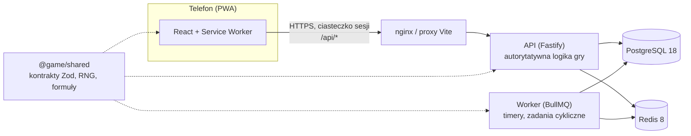

# Zapomniany Brzeg

Mobilna gra webowa (PWA) typu PvE RPG w mrocznym, lovecraftowskim klimacie, wzorowana mechanicznie na Isekai Guardians. Projekt gry opisuje dokument projektowy (GDD).

To repozytorium zawiera **fundament techniczny** i kolejne etapy gry według GDD: monorepo, klienta PWA, autorytatywny serwer API, bazę z migracjami, kolejkę zadań i logowanie. Co wchodzi w który etap, opisują sekcje poniżej.

## Stos technologiczny i uzasadnienie

| Warstwa          | Wybór                                                                                  | Dlaczego                                                                                                                                                                                                                                                                                          |
| ---------------- | -------------------------------------------------------------------------------------- | ------------------------------------------------------------------------------------------------------------------------------------------------------------------------------------------------------------------------------------------------------------------------------------------------- |
| Monorepo         | **pnpm 12** (workspaces) + **Turborepo 2.11**                                          | Ścisła izolacja zależności (brak „fantomowych” importów), szybkie instalacje, cache zadań i graf zależności (`^build`), dzięki któremu pakiet współdzielony buduje się przed aplikacjami.                                                                                                         |
| Język            | **TypeScript 6.0** (strict, `exactOptionalPropertyTypes`, `noUncheckedIndexedAccess`)  | Jeden język i jedne typy od bazy po UI. TypeScript 7 (natywny kompilator) nie jest jeszcze wspierany przez typescript-eslint (wymaga `<6.1`), więc przejdziemy na niego, gdy pojawi się wsparcie.                                                                                                 |
| Klient           | **React 19** + **Vite 8** + **vite-plugin-pwa 2** (Workbox) + **Tailwind CSS 4**       | Gra to aplikacja za logowaniem — SEO i SSR nic nie dają, więc Next.js byłby zbędnym narzutem. Vite daje najszybszy build i najprostszą PWA (manifest, service worker, offline dla zasobów statycznych), a wynik to statyczne pliki do CDN.                                                        |
| Routing i dane   | **React Router 8** + **TanStack Query 5**                                              | Sprawdzony routing deklaratywny; TanStack Query zarządza stanem serwera (cache, ponawianie, odświeżanie po powrocie do karty), co pasuje do gry asynchronicznej.                                                                                                                                  |
| API              | **Fastify 5** + **Zod 4**                                                              | Szybki i lekki, bez ceremonii NestJS. Gotowe pluginy (cookie, helmet, rate-limit) i `inject()` do testów bez sieci. Zamiast tRPC wybraliśmy zwykłe REST + współdzielone schematy Zod: typy są end-to-end tak samo, a API zostaje standardowym HTTP (logi, cache, curl, przyszli klienci natywni). |
| Baza             | **PostgreSQL 18** + **Drizzle ORM 0.45** + drizzle-kit                                 | Transakcje, ograniczenia `CHECK`/`UNIQUE` i blokady wierszy są kluczowe dla księgi walut i anty-cheatu (GDD rozdz. 9). Drizzle jest „SQL-first”, bez silnika binarnego (w odróżnieniu od Prismy), a migracje to czytelne pliki SQL w repo. PostgreSQL 18 daje natywne `uuidv7()`.                 |
| Timery i kolejki | **Redis 8** + **BullMQ 6** (osobny proces workera)                                     | GDD opiera grę na timerach (`TimedActivity`) i zadaniach cyklicznych (rozdz. 9.3). Redis obsługuje też limit prób logowania.                                                                                                                                                                      |
| Czas rzeczywisty | **WebSocket — celowo jeszcze nie**                                                     | Rozgrywka jest asynchroniczna (timery + Web Push). Gdy dojdą czat, loże i rajdy na żywo: `@fastify/websocket` + Redis pub/sub w procesie API.                                                                                                                                                     |
| Uwierzytelnianie | E-mail + hasło, **Argon2id**, sesje w PostgreSQL, ciasteczko `httpOnly` `SameSite=Lax` | Sesje nieprzezroczyste (w bazie tylko skrót SHA-256 tokenu) można natychmiast unieważnić (wylogowanie, ban) — w przeciwieństwie do JWT. API i PWA dzielą origin (proxy), więc nie potrzeba CORS.                                                                                                  |
| Testy            | **Vitest 5**, Testing Library, **Playwright 1.64**                                     | Jednostkowe i integracyjne (prawdziwy PostgreSQL i Redis), E2E na emulowanych telefonach: Pixel 7 (Chromium) i iPhone 14 (WebKit; ekran 390×844, jak w definicji ukończenia GDD).                                                                                                                 |
| Jakość           | **ESLint 10** (typescript-eslint `strictTypeChecked`, react-hooks), **Prettier 3**, CI | Reguły z informacją o typach łapią błędy asynchroniczne i niebezpieczne `any`. GitHub Actions uruchamia wszystko przy każdym PR.                                                                                                                                                                  |
| Uruchomienie     | **Docker Compose**, Node.js **24 LTS**                                                 | Jedno polecenie stawia bazę i Redisa do developmentu albo pełny stos (API, worker, migracje, PWA za nginx).                                                                                                                                                                                       |

## Architektura



### Autorytatywny serwer

Zgodnie z GDD (rozdz. 9) **klient jest tylko oknem**:

- Klient wysyła **intencje** (np. „rozpocznij zlecenie”), nigdy wyników. Nagrody, walka, losowania i poziomy zmieniają się wyłącznie na serwerze, w transakcjach bazy.
- **Czas** pochodzi z zegara serwera (`Clock` w API, endpoint `GET /api/v1/time`). Logika nie woła `new Date()` bezpośrednio, więc testy używają wirtualnego zegara.
- **Losowanie**: serwer wybiera ziarno (CSPRNG) i rozstrzyga rzut deterministycznym generatorem z `@game/shared` (sfc32, wyłącznie arytmetyka 32-bitowa). Zapisane ziarno pozwala odtworzyć walkę lub łup (powtórki, audyt).
- **Formuły** (np. krzywa doświadczenia z GDD 10.2) są w `@game/shared` jako czyste funkcje. Serwer liczy nimi stan gry, klient — tylko podgląd (np. pasek XP). Wartości są zablokowane **wektorami referencyjnymi** (`GOLDEN_VECTORS`), które sprawdzają testy pakietu, serwera i klienta (przez potok Vite). Wersję balansu oznacza `BALANCE_VERSION`.

## Struktura repozytorium

```
apps/
  api/          serwer Fastify, schemat bazy (Drizzle), migracje SQL (drizzle/), worker BullMQ
  web/          klient PWA (React, Vite, Tailwind), ikony, konfiguracja nginx
packages/
  shared/       kontrakty API (Zod), balans, dane statyczne, deterministyczny RNG, krzywa XP
tools/
  balance/      symulacje Monte Carlo balansu (GDD 10.12)
e2e/            testy Playwright na widoku mobilnym
docker-compose.yml, turbo.json, eslint.config.js, .github/workflows/ci.yml
```

## Szybki start

Wymagania: **Node.js 24 LTS** (minimum 22.22), **corepack** (dostarcza pnpm w wersji z `package.json`) i **Docker**.

```bash
corepack enable
pnpm install
cp .env.example .env
docker compose up -d                  # PostgreSQL 18 + Redis 8
pnpm db:migrate                       # migracje bazy
pnpm dev                              # API na :3000, PWA na :5173 (proxy /api → API)
pnpm --filter @game/api dev:worker    # opcjonalnie: worker kolejki timerów
```

Otwórz <http://localhost:5173> (najlepiej w trybie urządzenia mobilnego w DevTools) i załóż konto.

Pełny stos w kontenerach (migracje, API, worker, PWA za nginx):

```bash
docker compose --profile app up --build   # → http://localhost:8080
```

## Polecenia

| Polecenie                       | Co robi                                                      |
| ------------------------------- | ------------------------------------------------------------ |
| `pnpm dev`                      | tryb deweloperski wszystkich pakietów (watch)                |
| `pnpm build`                    | build produkcyjny (shared → api, web)                        |
| `pnpm lint`                     | ESLint z regułami typowanymi                                 |
| `pnpm typecheck`                | kontrola typów wszystkich pakietów                           |
| `pnpm format` / `:check`        | Prettier                                                     |
| `pnpm test`                     | testy jednostkowe (shared, api, web)                         |
| `pnpm test:integration`         | testy integracyjne API na prawdziwym PostgreSQL i Redisie    |
| `pnpm test:e2e`                 | testy E2E Playwright (buduje i uruchamia API oraz PWA)       |
| `pnpm db:generate`              | generuje migrację SQL ze zmian w `apps/api/src/db/schema.ts` |
| `pnpm db:migrate`               | stosuje migracje                                             |
| `pnpm --filter @game/web icons` | odtwarza ikony PWA z `apps/web/public/favicon.svg`           |

## Testy

- **Jednostkowe** (`pnpm test`) — nie wymagają infrastruktury.
- **Integracyjne** (`pnpm test:integration`) — wymagają `docker compose up -d`. Używają osobnej bazy `game_test` (tworzonej automatycznie) i bazy Redis nr 1, więc nie dotykają danych deweloperskich. Adresy można nadpisać zmiennymi `TEST_DATABASE_URL` i `TEST_REDIS_URL`.
- **E2E** (`pnpm test:e2e`) — wymagają PostgreSQL i Redisa. Za pierwszym razem zainstaluj przeglądarki: `pnpm --filter @game/e2e exec playwright install chromium webkit`. Playwright uruchamia zbudowane API (port 3100, z migracjami), worker kolejki i `vite preview` (port 4173). API działa wtedy z `ENABLE_TEST_CONTROLS=true`: zegar serwera można przesunąć (`POST /api/test/clock/advance`), a rozstrzyganie timerów wywołać ręcznie (`POST /api/test/jobs/activities-sweep`). Konfiguracja odrzuca tę flagę na produkcji. Zegar jest wspólny, więc testy E2E idą po kolei.
- **Balans** (`pnpm --filter @game/balance simulate`) — symulacja Monte Carlo 600 dni gracza-bota (GDD 10.12) na tych samych funkcjach co serwer; testy pakietu `tools/balance` (część `pnpm test`) zgłaszają alarm przy odchyleniu > 15% od tabel GDD.

## API (v1)

| Metoda i ścieżka                         | Opis                                                     |
| ---------------------------------------- | -------------------------------------------------------- |
| `GET /api/health`                        | stan bazy i Redisa (200 albo 503)                        |
| `GET /api/v1/time`                       | czas serwera                                             |
| `POST /api/v1/auth/register`             | konto + postać (jedna na konto) + sesja                  |
| `POST /api/v1/auth/login`                | logowanie (limit prób na IP)                             |
| `POST /api/v1/auth/logout`               | unieważnienie sesji                                      |
| `GET /api/v1/me`                         | konto i postać zalogowanego gracza                       |
| `GET /api/v1/dashboard`                  | pulpit Dom: czas serwera, postać, zasoby, Srebro, timery |
| `POST /api/v1/activities` ¹              | start zlecenia (koszt Wigoru, ziarno, timer)             |
| `POST /api/v1/activities/:id/claim` ¹    | odbiór nagrody jednego zlecenia                          |
| `POST /api/v1/activities/claim-all` ¹    | odbiór wszystkich gotowych nagród                        |
| `GET /api/v1/push/config`                | czy Web Push działa + klucz publiczny VAPID              |
| `POST/DELETE /api/v1/push/subscriptions` | subskrypcja powiadomień urządzenia                       |

¹ Wymaga nagłówka `Idempotency-Key` (GDD 9.2). Powtórka z tym samym kluczem zwraca zapisaną odpowiedź z nagłówkiem `idempotent-replayed: true`; ten sam klucz z inną treścią to błąd 422.

Błędy mają postać `{ "error": { "code": "…", "message": "…" } }`; kody są w `ERROR_CODES` w `@game/shared`.

## Model danych

Zgodnie z GDD (rozdz. 8):

| Tabela                               | Rola                                                                                                          |
| ------------------------------------ | ------------------------------------------------------------------------------------------------------------- |
| `accounts`, `characters`, `sessions` | konto, jedna postać na konto (unikalne imię), sesje                                                           |
| `resource_states`                    | Życie, Wigor, Znój, Poczytalność z czasem ostatniej zmiany — leniwa regeneracja                               |
| `wallet_entries`                     | księga walut: każdy wpis ma `delta`, `balance_after` i klucz idempotencji; saldo nie jest nigdzie nadpisywane |
| `timed_activities`                   | jeden model wszystkich timerów: ziarno wyniku, `balance_version`, status `active → completed → claimed`       |
| `idempotency_keys`                   | odpowiedzi do powtórek żądań (sprzątane po dobie)                                                             |
| `audit_log`                          | rejestracja, logowanie, start i odbiór aktywności (z IP i urządzeniem)                                        |
| `push_subscriptions`                 | urządzenia gracza dla Web Push                                                                                |

Zmiany schematu: edytuj `apps/api/src/db/schema.ts`, uruchom `pnpm db:generate` i dołącz wygenerowany plik SQL do commita.

## Etap 0 (GDD 11) — jak działa

- **Balans** (`packages/shared/src/balance.ts`, `BALANCE_VERSION`): limity i regeneracja zasobów (10.1), czasy i koszty zleceń, nagrody XP (10.2) i Srebra (10.5), krzywa XP z GDD 1.1. Te same funkcje liczą stan na serwerze i podgląd w kliencie.
- **Leniwa regeneracja**: w bazie jest wartość z chwili ostatniej zmiany; bieżącą wartość liczy `materializeResource` z czasu serwera. Niepełny tik nie przepada, a pełny zasób zaczyna odliczanie dopiero od wydania.
- **Księga walut**: wpisy postaci serializuje blokada wiersza postaci, więc nie ma podwójnego wydania; nagroda za aktywność ma klucz `activity:<id>:reward`, więc nie wypłaci się dwa razy.
- **Timery i scheduler**: start zapisuje ziarno (CSPRNG) i `end_at`. Worker co minutę rozstrzyga zakończone timery (`SKIP LOCKED`, więc może działać wiele workerów) i kolejkuje powiadomienia. Codziennie o 00:00 UTC sprząta wygasłe sesje i klucze idempotencji. Pulpit rozstrzyga timery także od razu, gdy gracz wraca do gry.
- **Dane statyczne** (`packages/shared/src/data`, `STATIC_DATA_VERSION`): walidowane schematem przy starcie serwera — z błędnymi danymi API nie wstanie.
- **Web Push**: klucze VAPID z `pnpm --filter @game/api vapid:generate` (zmienne `VAPID_PUBLIC_KEY`, `VAPID_PRIVATE_KEY`). Bez nich push jest wyłączony, a interfejs to pokazuje. Treść jest szyfrowana (aes128gcm) i podpisana; subskrypcje odrzucone przez serwis push (404/410) są usuwane.
- **Zlecenia próbne**: Etap 0 zawiera trzy zawsze udane „zlecenia próbne” Urzędu jako nośnik timerów, księgi i powiadomień. Pełne Zlecenia (szansa, porażki, pętla 11, biegłość) to Etap 1.
- **i18n**: teksty interfejsu są w `apps/web/src/i18n/pl.ts`; kolejny język to plik o tej samej strukturze.

Poza Etapem 0 zostają m.in. Patronat (Etap 9; GDD 1.1: max Wigor 200) i godziny ciszy powiadomień.

## Etap 1 — Pierwsza noc w Soli

Zamknięta pętla w Soli: samouczek w kostnicy, trening w Fechtowni (Piwnica i Sala Kapitańska), Łowy na Kręgach IX–VII, silnik walki z dziennikiem, zlecenia trzech rodzajów z szansą, biegłością i pętlą do 11, ekwipunek ośmiu slotów i trzy klasy, sklep, Kasa, Przytułek po śmierci i progi Poczytalności. Test akceptacyjny: nowy gracz dochodzi do 5. poziomu, zakłada zestaw Rzeźnika i ustawia zlecenie w pętli.

Świadomie odłożone wewnątrz Etapu 1 (opisane przy liczbach jako „założenie”, tam gdzie GDD nie podaje wartości): mikstury i laudanum mają dane i ceny, ale leczenie w Przytułku i Sanatorium jest uproszczone do timera; Kalendarz Pamięci ma kamienie milowe w danych, odbiór dziennego zadania przyznaje XP i Kawę. Pogłębienie zleceń, Podręczniki i Kuźnia to późniejsze etapy.

## Etap 2 — Studnia, Seanse i Portal

Rdzeń Portalu Bogów dla Domen 1–2 (Bokrug oraz Dagon i Matka Hydra): 160 walk, modyfikatory _Zemsta Ib_ i _Ciśnienie_, nagrody i pierwsze przejścia według rozdziału 10.13. Pęk Kluczy regeneruje 1 Klucz Snu na 4 godziny, do 6; klucze z łupu nie mają limitu. Każda walka zużywa klucz w tej samej transakcji co wynik. Porażka zwraca 1 Odłamek (5 Odłamków = 1 klucz) i nie rani ciała — nie ma Przytułku. Aura zabiera prawdziwą Poczytalność.

Klucze i Odłamki dochodzą też ze źródeł Etapów 1–2: dzienne zadanie (1 klucz), zlecenia od 1 godziny (20%, a 8 godzin — pewny Odłamek), nazwani Łowów z Kręgu V i wyżej (10%), pierwsze zabicie Strażnika Studni (2 klucze), Grawer (3 dziennie) i rozkład przeklętego przedmiotu (10%). Kręgi VI–IV są otwarte. Studnia ma piętra 1–50 i Szept co 5 pięter. Seans (3 Świece na start) losuje spośród 30 Ech do rzadkości Widma, z litością z rozdziału 10.8.

Formuły są w `packages/shared/src/portal.ts` (`BALANCE_VERSION` 3). Testy: chi-kwadrat miliona Seansów, regeneracja Pęku na wirtualnym zegarze, odrzucenie pominięcia podetapu, jednorazowość pierwszego przejścia i 100 równoległych żądań z jednym kluczem idempotencji.

Świadomie odłożone, żeby nie udawać systemów z późniejszych etapów:

- Symulacja „Domena 1 w dniu 11” na interpolacji tabeli statystyk z 10.3 wychodzi w dniu 13 (około 18% obok celu). Pełny model treningu i sprzętu z 10.3 nie jest jeszcze w Monte Carlo. Liczby nie zostały dopasowane na siłę.
- Odłamki Meteorytu do Grawera wypadają przy pierwszym Strażniku Studni. Właściwe źródło to Domena Koloru (Etap 3).
- Szept „Poczytalność nie spada” działa tylko w walce Studni, nie zamraża regeneracji paska.
- Sprzęt z Seansu to srebro, nie przedmiot. Wzmacnianie w Kuźni, Stopnie 4–5, Podręczniki, osiągnięcia i tytuły nie wchodzą w ten etap.
- Gwiazdki, Sigile jako warunek wejścia i Patronat zostają przy swoich etapach (3 i 9). Sigile następnego boga za awatara są tylko zapisane.

## Etap 3 — Wiedza Zakazana i Sigile

Wiedza Zakazana (0–80) obniża maksimum Poczytalności: `100 − floor(0,75 · Wiedza)`. Przy 80 maksimum wynosi 40. Nadwyżka ponad nowy limit zostaje do najbliższej zmiany paska — ta sama zasada co przy nagrodach ponad limit. Blizna Głosu dokłada karę −5 (minimum paska to 1). Załamanie rzuca Bliznę Umysłu (25%, maks. 3). Progi Poczytalności obejmują Krawędź (10–1%): Panika 10%, a przy krytycznej Krawędzi +20% do obrażeń. Blizna Pustych Oczu daje odporność na Panikę. Efekty obłędu w interfejsie (winieta, odwrócony sigil) mają wyłącznik.

Sprawy (Drobne i Poważne) powstają z ziarna trzymanego tylko w bazie. Publiczny widok nie zawiera kluczy `solution`, `pointsAt`, `answerIndex`, `correctIndex`, `truthful` ani `seed`. Ścieżka przeszukań (Znój 3–5, Wiedza 0) zawsze wskazuje właściwą odpowiedź, więc 3/3 da się dojść. Przesłuchanie może kłamać i może nic nie ujawnić. Ukryty trop widać dopiero przy Poczytalności ≤ 30%. Wizja zawęża do dwóch indeksów. Porażka Sprawy znika Mieszkańca z przesłuchania „kto?” i podnosi niepokój na 24 h. Drobna 3/3: 1 Klucz Snu, +1 Wiedzy, +40 reputacji Zakonu. Poważna 3/3: 3 Odpryski Sigilu boga Sprawy, +2 Wiedzy, +80 reputacji i 1 Ichor (założenie tego etapu; właściwe rytuały są w Etapie 7). Częściowa odpowiedź: +10 reputacji i 15 srebra.

Cztery frakcje Soli, Pieczęcie i sklep Ambasadora (znajomy, próg 280). Podróż jest dopiero w Etapie 4, więc przepustka i skrzynia płacą srebrem (20 i 50), a nie biletem. Wytrych daje +1 Skrytości, świeca +1 Świecę. Kolegium ma pięć kursów; odbiór jest jawnym żądaniem, nie dzieje się przy odczycie. Konstelacja: punkty to poziom minus odblokowane węzły; lampa i sól wykluczają się; wygasłą gwiazdę odsłania tom. Kaplica trenuje Opanowanie, Wgląd i Skrytość za 5 Znoju. Opanowanie wchodzi do utraty Poczytalności od Grozy.

Bestiariusz: strony przy 10/50/200/1000 zabiciach typu `domena:etap`. Czwarta strona daje raz 1 Sigil tego boga. Księgi Domen wymagają Wiedzy `3·(k−1)`; lektura daje 1 Sigil i, przy tomie wygasłym, otwiera Konstelację. Kalendarz: kamienie 7/14/21/28 dają 1/1/2/3 Sigile ostatnio odblokowanego boga przy odbiorze dziennego zadania. Przerwa serii cofa do ostatniego kamienia bez ponownej wypłaty. Pogłębienie zlecenia podnosi próg statystyki ×1,6 na stopień (bez twardego sufitu 70% szansy). Od IV stopnia sukces zabiera `2·(stopień−3)` Poczytalności i daje 1 Odprysk Sigilu ostatniego odblokowanego boga. Blizna Liczenia: +5% szansy zlecenia i +10% czasu.

Portal, część 2: Domena 3 (Kolor spoza Przestworzy, modyfikator Spust — co rundę −2% maks. Życia i −1 Poczytalności). Każda wygrana w Domenie 3 daje +1 Odłamek Meteorytu; Strażnicy Studni nadal dają 2, jak w Etapie 2. Sigil jest wymagany, gdy walka ma gwiazdkę albo jest to etap 6+ Domeny 3+. Taka walka zużywa Sigil zamiast klucza i nie zwraca Odłamka przy porażce. ★1–★5 Domen 1–3: statystyki ×1,5ⁿ, Życie i obrażenia ×1,25ⁿ. Przekucie na Ołtarzu: 3 klucze + 1 Ichor → 1 Sigil odblokowanego boga, maks. 5 na dobę UTC; od Wiedzy 20 bez Ichoru. Wymiana: dokładnie 10 Odprysków → 1 Sigil. `BALANCE_VERSION` 4.

Symulacja (interpolacja tabeli 10.3, próg wejścia przy statystyce ≥ 1,0405× wroga):

- Domena 3 kończy się w dniu 70. Cel GDD to dzień 62 ±15% (do 71). Model się mieści, około 12,9% obok. 7 i 8,9 klucza dziennie dają ten sam dzień, bo ogranicza statystyka.
- ★1 Bokruga przy 8,9 klucza dziennie (aktywny F2P z 10.13) kończy się w dniu 22. „Osiągalne ok. dnia 18” jest obok o około 22%. Odblokowanie ★1 jest w dniu 13, razem ze snem Domeny 1. Krzywej nie dociągamy.
- Domena 1 nadal kończy się w dniu 13 wobec celu dnia 11 (luka z Etapu 2).

Świadomie odłożone w Etapie 3: Spisek, mutacja dzielnicy i Zegar Koniunkcji przy przegranej Sprawie, Rytuał Pieczęci z 20% na drugi Sigil (Etap 7), Patronat. Domena 4 i cztery miasta weszły w Etapie 4.

## Etap 4 — Cztery miasta

Ilmar, Mgławiec i Kres dochodzą do Soli. Doba gry trwa 4 godziny, a ostatnia godzina to Godzina Wilka. Pogoda i pływ zmieniają się co 2 godziny; pogoda jest deterministyczna ze znacznika czasu (`pogoda:` + numer slotu). Podróż zużywa czas z tabeli poniżej, wydłuża ją mgła (×1,1) i sztorm (×1,25). W Godzinie Wilka zasadzka ma 10% szansy, Skrytość obniża ją o 0,5 punktu procentowego za punkt, nie niżej niż 1%. Rodzaj zasadzki (walka, myto, ładunek) jest losowany przy wyjściu i rozliczany raz, przy wjeździe. Walka zabiera 10 Życia, ale zostawia co najmniej 1. Myto zabiera 2 Poczytalności. Ładunek zrzuca ostatnią rybę z kosza. Eskorta nie wchodzi w ten etap.

Czasy bazowe, w obie strony takie same, są założeniem wewnątrz widełek 20–90 minut z GDD: Sól–Ilmar 40, Sól–Mgławiec 50, Sól–Kres 70, Ilmar–Kres 60, Kres–Mgławiec 80, Ilmar–Mgławiec 90. Wierzchowce wynajmuje się tylko w Mgławcu, na 1–7 dni, a nowy wynajem zastępuje stary: Ślepy Kuc −15% / 40 srebra za dzień / +2 miejsca, Nocny Ogar −30% / 90 / +4, Bezlicy −50% / 200 / +6 / −1 Poczytalności / poziom 30. Premia Ogaru do skrytości nocą nie zmienia jeszcze szansy zasadzki.

Pieczętowanie Krwią jest w Ilmarze: 20% maksimum Życia, 3 razy na dobę UTC, raz na przedmiot, +8% statystyk tego przedmiotu. Srebro `15·poziom` to założenie. Oczyszczenie w Kresie: 50 srebra zdejmuje 10 Skażenia (założenie). Sanatorium Wysokie: 30 minut, +20 Poczytalności, srebro `round(30·poziom^1,1)`. Reputacja miasta rośnie o 1 przy usłudze, zbiorze i rozmowie z mieszkańcem. Mieszkańcy Ilmaru, Mgławca i Kresu żyją w stanie świata; Sól zostaje przy notatniku z Etapu 3. Słuchaczka Nera jest w Kresie.

Połów: 1 Znój i 1 haczyk (start: 5), kosz do 10 ryb. Serwer wysyła ziarno, chwilę brania i okno, bez środków stref. Idealny hol — reakcja dokładnie w chwili brania i napięcie w środku każdej strefy — jest flagowany i nadal łapie rybę. Tolerancja to ±150 ms. Hol z przyszłości (późniejszy niż czas serwera + 150 ms) jest odrzucany. Osobliwość ma 8% ze ziarna. Legenda tygodnia (poniedziałek UTC, raz na łowisko): złowiona, nie osobliwość, waga ≥ 3500 g. To założenie w miejscu Regat. Dziennik trzyma 20 ostatnich holów.

Ogród od poziomu 8, cztery grządki. Woda w połowie fazy. Bez wody roślina usycha dokładnie w chwili `zasadzenie + faza/2 + 2·faza`. Piołun ma fazę 1 h, więc usycha po 2,5 h. Sadzenie daje 5 PD, podlewanie 3. Ziarno z meteorytu wymaga Popiołu Koloru i nie jest w sklepie Zielarki (srebro 0). Startowe nasiona: 2 piołuny.

Portal: Domena 4, Ghaal-Tureth, modyfikator Tętno Skały. W rundach 5, 10, 15, 20 i 25 jest 10% szansy, że postać traci turę, gdy Opanowanie jest poniżej 200. Piętno Żyły Kamiennej Krwi (`vein-blood`) działa tylko w walce snu: 5% szansy, że wróg traci turę. Inne piętna zapisują się na przedmiocie okultystycznym lub przeklętym. Pieczęć +8% liczy się w `computeLoadout`, gdy podano identyfikatory zapieczętowanych sztuk. Gwiazdki zostają przy Domenach 1–3. Wejście do Portalu jest na Drodze w każdym mieście. Podróż blokuje zlecenia i walkę w Portalu. `BALANCE_VERSION` 5.

Symulacja dnia 99 dla Domeny 4 nie jest warunkiem akceptacji tego etapu i nie została dociągnięta. Patronat (maks. Wigor 200) zostaje w Etapie 9.

## Etap 5 — Port i rynek

Giełda Portowa przyjmuje towary stakowalne: plony, ryby, materiały Domen, kopie ksiąg, filety i przetwory. Klucze Snu i Sigile nie mają identyfikatora towaru i są odrzucane. Zlecenie limit zostaje w księdze, zlecenie market zjada najlepsze ceny i nie zostawia reszty. Cena transakcji to cena zlecenia leżącego. Prowizja sprzedającego to 3% (`floor`), opłata wystawienia 1% od nominału (przy market — od tego, co faktycznie zeszło). Kupno limit blokuje srebro, sprzedaż blokuje towar. Zlecenie gaśnie po 7 dniach i zwraca resztę. Księga jednego towaru jest blokowana na czas dopasowania.

Licytacja i handel bezpośredni biorą ten sam przedmiot pod blokadę wiersza. Oferty licytacji nie da się wycofać. Handel i poczta z załącznikiem wymagają poziomu 10 (Patronatu jeszcze nie ma, więc nie ma drugiej furtki). Odbiór listu jest jawnym żądaniem.

Pięć stacji warsztatu: Kuźnia, Destylarnia, Introligatornia, Preparatornia, Odlewnia Świec. Koszt poziomu to założenie `100 · nowy poziom`. Odlewnia od poziomu 5 daje Świecę Progu: 1 Odłamek Klucza na 24 h. Introligatornia kopiuje tom, który postać już przeczytała. Kuchnia filetuje rybę z kosza. Skrzynia przemytnika ma 2 miejsca plus miejsca wierzchowca; Kupiec płaci według miasta. Napad w drodze zdejmuje jedną sztukę ze skrzyni. Czat ma kanały Ogólny, Handel i Pomoc; trzy zgłoszenia chowają wiadomość.

Portal: Domena 5, Nodens, modyfikator Sąd Pradawnego. Przy Skażeniu poniżej 20 obrażenia gracza ×1,1, powyżej 50 ×0,8. Do Etapu 7 Skażenie z walki wynosi 0, więc sąd daje tylko premię. Gwiazdki zostają przy Domenach 1–3. `BALANCE_VERSION` 6. Patronat nie wchodzi w ten etap.

## Etap 6 — Loże

Loża ma role (Mistrz, Starszy, Skarbnik, Brat lub Siostra, Nowicjusz). Uprawnienia są w `lodgeAllows`. Darowizna zasila skarbiec i XP loży (2% XP członków + 1 XP za srebro). Poziom rośnie co 10 000 XP — to założenie, GDD nie podaje progu. Umiejętność _Klucznik_ podnosi Pęk członków z 6 do 7.

Zwój Przyzwania Stopnia I–III kosztuje 50 000 i podwaja się co stopień. Zapisy trwają 30 minut. Rozstrzygnięcie to jedna walka `simulateCombat`: siła koła to suma poziomów zapisanych. Wygrana daje tyle Sigili Króla w Żółci, ile stopień Zwoju (po jednym na pierwszych zapisanych), Serca Demoniczne i srebro dzielone po równo. Reszta srebra wraca do skarbca.

Kuter wymaga umiejętności _Flota_ i 20 000 srebra (założenie). _Coś Większego_ (15%, założenie) przy co najmniej trzech zapisanych kończy się walką i połowem, inaczej cięciem sieci. Sny: Spokojny (+20% regeneracji Poczytalności, maks. 12 h), Głębiny (30% Odłamek, 20% koszmar −5 Poczytalności) i Wspólny (wymaga loży, 1 Odłamek). Mentor w Urzędzie od poziomu 15. Spisek otwiera członek loży; rozwiązanie 3/3 daje 2 Sigile.

Portal: Domena 6, Król w Żółci, modyfikator Żółty Znak (Panika ×2; przy Poczytalności poniżej 30% obrażenia ×1,15). Przebudzenie Boga rotuje Domenę co poniedziałek UTC po kolei 1–6 (próg „10% aktywnych” nie ma jeszcze populacji — założenie). Wejście: pokonany awatar i Sigil. Wypłata rankingu (Kwity: miejsce 1 dostaje 3, miejsca 2–10 po 1) idzie dokładnie raz, pod blokadą tygodnia. Test wypłaty sadzi miejsca w bazie: gołe pięści nie zwalają awatara w 25 rundach, a krzywej awatara nie ruszano. Kto nie pokonał awatara budzącego się boga, dostaje +25% materiałów tej Domeny w Śnie. Gwiazdki zostają przy Domenach 1–3. `BALANCE_VERSION` 7. Patronat nie wchodzi w ten etap.

## Etap 7 — Dom i Krąg

Dom ma pięć typów z ceną, czasem budowy i utrzymaniem z GDD 5.21. Sprzedaż zwraca 70% ceny i czyści pokoje. Utrzymanie rozlicza się leniwie przy wejściu na próg: dzień bez srebra to zaległość i pokoje gasną. Koszt ulepszenia pokoju to założenie `1 000 × nowy poziom`, maksimum 5. Mosiądz, szkło, marmur i ichor domu kapitana i dworu nie mają liczb w GDD — założenie: 40, 20, 30 i 1.

Sypialnia daje +5% Wigoru, a kaplica regenerację Poczytalności, ale tylko jako liczba na progu. Tik Wigoru zostaje 5 na 10 minut, żeby klient i serwer nie rozjechały się na każdym odczycie zasobów.

Sześć kategorii rytuałów. Szansa i wagi są w `ritualChance` / `ritualWeightBp` (GDD 10.9). Przy `p = 0,5` wagi to 4000 / 1000 / 4250 / 750. Katastrofa otwiera krótką walkę w domu. Rytuał Pieczęci na ołtarzu i w piwnicy: 10 Odprysków daje 1 Sigil, 20% na drugi. Ołtarz jest natychmiastowy i nie wymaga piwnicy. Rytuał w piwnicy może się nie udać — Odpryski i tak giną przy starcie.

Pętla wiedzy: Sprawa 3/3 kładzie Psałterz Soli i 12 świec na półkę. Bez półki tego tomu nie da się otworzyć. Lektura daje `round(wartość × max(0, 1 − Wiedza/100))`. Rytuał otwarcia kryjówki chce przeczytanego tomu i piwnicy. Kryjówka daje 250 srebra raz.

Przysięga tylko w poniedziałek UTC, skutek od wtorku 00:00 UTC. Ten sam Śpiący podnosi Krąg do 5. Zmiana Śpiącego resetuje Krąg i nakłada Gniew Porzuconych (−5% statystyk na 7 dni). Pominięty tydzień Kręgu nie zeruje. W walce Portalu krawędź aspektu to +20% / −20% według cyklu Głębia → Zimny Ogień → Rój → Kość → Wicher → Pustka → Blade Światło. Krąg dodaje +1% za poziom (założenie) do premii własnego aspektu i +1% materiałów w Domenie tego aspektu. Poza Portalem i bez przysięgi mnożnik to 1, więc stare logi walki zostają.

Kult od poziomu 20 i Kręgu 2. Rangi po liczbie zleceń: 0 słuchacz, 3 akolita, 8 kapłan, 15 hierofant (założenie). Zlecenie daje 200 srebra i 15 Podejrzenia (założenie). Przy 100: reputacja Zakonu 40, 500 srebra męczennika raz na dobę i 7 dni bez zleceń Zakonu.

Skażenie ma część całkowitą i dziesiąte. Domena 7+ i przeklęty przedmiot dokładają 0,1 na walkę. Sól Gwiezdna +8. Progi 20/40/60/80 dają wybór 1 z 3 mutacji. Sól na Progu przez 4 godziny połowi szansę zasadzki. Rozkład poniżej 25 spada o 1 na dobę UTC.

Portal: Domena 7, Shub-Niggurath, modyfikator Płodność. Co trzecią rundę obrażenia wroga rosną o 10% kumulatywnie i bez dodatkowego losu. Gwiazdki zostają przy Domenach 1–3. `BALANCE_VERSION` 8. Patronat nie wchodzi w ten etap. Krzywych tempa z wcześniejszych etapów nie ruszano.

## Etap 8 — Wyprawy

Wyprawy 1–4: Kanały pod Solą, Wrak „Miłosierdzia”, Archiwum pod Ilmarem, Lodowe Krypty Kresu. Ys-Kahal i Oko Czerni zostają na Etap 10. Każda ma te same cztery przeszkody (Rzeźnik, Strzelec, Okultysta, Alienista). Kanały biorą drużynę 3, więc zawsze brakuje co najmniej jednej klasy.

GDD nie podaje tabeli utraty łupu. Założenie, które sprawdza test: każda pominięta przeszkoda zabiera `floor(pula × 1500 / 10000)` (15% puli bazowej) i 5 wspólnej Poczytalności. Pula bazowa to `100 × poziom wyprawy × liczebność`. Wejście kosztuje `poziom postaci × 50` srebra od każdego, kto nie jest asystą — GDD wymienia lampy i liny, ale nie ma ich identyfikatorów. Snapshot klasy zapisuje się przy starcie i rozliczenie nie czyta później sprzętu. Wspólna Poczytalność to średnia (w dół). Alienista leczy ją o 8, nie powyżej średniej maksimów, zanim spadnie za przeszkody. Poniżej 25% maksimum losowy członek „słyszy Śpiącego”, a łup spada do 80%. Lider dzieli pulę po stratach; suma musi się zgadzać. Asysta nie dostaje srebra, doświadczenia ani łupu. Dostaje +10 reputacji Zakonu. Doświadczenie zwykłego udziału to jedna dziesiąta srebra. Osobisty łup to 1 Pieczęć Zakonu i 1 Odłamek Klucza.

Okna: przypływ to wysoki pływ, noc to Godzina Wilka, pt–nd to piątek, sobota i niedziela UTC. Tydzień liczy się od poniedziałku UTC, jak Przebudzenie.

Rozdział 5.5 mówi, że Alienista wchodzi w etapie 9. Rozdział 11 kładzie go w Etapie 8 i tego słuchamy. Specjalność to +30% Opanowania, gdy klasa jest aktywna. Nie ignoruje Hartu ani Uniku. Leczenie drużyny jest w rozliczeniu wyprawy, nie w pojedynku.

Eskorta: to samo miasto, po akceptacji. Szansa zasadzki spada o połowę po soli na progu, jeśli sól też działa. Eskorta przejmuje pierwszą walkę (podopieczny jej nie dostaje) i dostaje 1 Pieczęć Straży. Pierwsze zdarzenie, które zabiera Poczytalność (dziś myto, −2), jest mniejsze o 30%, czyli zostaje −1. Walka zasadzki nie zabiera dziś Poczytalności, więc tych 30% nie dokłada nowej straty.

Studnia schodzi do piętra 100. Od 50 każda walka, wygrana czy nie, dodaje 0,2 Skażenia. Od 70 Groza jest co najmniej 6, chyba że Szept wycisza ją do zera. Setne piętro nadal mówi, że głębiej prowadzi Bezdeń — ranking Bezdeni jest w Etapie 9.

Kręgi III–Zerowy są otwarte: wrogowie i śmieci doszły do katalogu. Stopnie 1–8 mają przedmioty; nazwy od Stopnia 4 powtarzają Stopień 1, bo GDD ich nie podaje. Awans Kręgu może zejść aż do Zerowego.

Portal: Domena 8, Cthulhu, R'lyeh, aspekt Głębia, modyfikator Sny R'lyeh. Co rundę −1 Poczytalności, a 10% ciosów gracza zakrzywia się w pudło. Ten rzut jest tylko przy tym modyfikatorze. Domena 9 zostaje zamknięta. Gwiazdki zostają przy Domenach 1–3. `BALANCE_VERSION` 9. Patronat nie wchodzi w ten etap.

Rozjazdu tempa Domeny 1 (dzień 13 wobec dnia 11 w GDD) ten etap nie rusza. Krzywych z wcześniejszych etapów też nie.

## Etap 9 — Latarnie i Koniunkcja

Zegar Koniunkcji trzyma się w punktach bazowych, 10000 = 100%. Dzień bazowy to 190 bp (1,9 pp). Mnożnik to `clamp(3000, 17000, 10000 + round(10000·(PK−PL)/(PK+PL+10·N)))`. Mianownik 0 zostawia mnożnik 10000. Surowa suma PL+PK gracza obcina się do 30 na dobę: pierwsze 15 liczą się w całości, kolejne 15 w połowie w dół, więc skuteczne maksimum to 22. To założenie, bo GDD nie rozcina dziennego sufitu. Dwa boty ze sprawą poważną (po 5 PL) dają 127 bp na dobę. Po 56 dobach zegar staje na 7112 bp, progi 2500 i 5000, finał „odparte” raz. 53. doba bez akcji dochodzi do 10000 i daje Wynurzenie. Nagrody są idempotentne: próg to 3 klucze z łupu, finał to 5 albo 2 Sigile Domeny 9, wyższa z ról Latarnika i kultu. Przyspieszony akt (1 min = 1 doba) działa tylko przy `NODE_ENV=test`. Produkcyjny odczyt Obserwatorium zakłada akt żywy.

Latarnie: siedem, po jednej na Śpiącego. Miasta: Ulthaeg, Zhar'Nuul i Omm w Soli, Ma'Ghulla w Mgławcu, Ossarath na Kresie, Ithrakel i Aelis w Ilmarze. Fazy UTC: pn–czw zgłoszenia, pt wybór, sobota 19:00–20:30 bitwa, poza tym sobota to wybór, niedziela wypłata. Stanowisko kosztuje 20 Wigoru. Wynik to stanowiska × 3. Ostatnia fala pada poniżej 3 stanowisk. Obie strony padają — Latarnia gaśnie i dokłada 80 PK do następnej doby. Sam pretendent bez obrońcy bierze Latarnię bez bitwy. Remis albo sam obrońca zostawia obrońcę. Pretendent to najwyższa zgłoszona obrona tygodnia (liczba 1–10000); licznika obrony regionu jeszcze nie ma. Loża trzymająca Latarnię musi się jej zrzec, zanim zgłosi się gdzie indziej. Jedno zgłoszenie na lożę na tydzień. Udział daje 2 klucze, zwycięstwo 1 Sigil stojącym. Podatek 1% obrotu giełdy idzie do skarbca loży, która trzyma Latarnię soli, ponad istniejące 3% prowizji sprzedającego.

Patronat: max Wigor 200 i tik Wigoru skrócony o 10%. Pęk kluczy co 3,5 h. Pieczęć Patrona (`seal:patron`) kosztuje 25 000 srebra — założenie — i jest towarem giełdy. Wykup przedłuża 30 dni od późniejszej z chwil: teraz albo obecny koniec. Świeca Patrona raz na dobę UTC, 5 kwitów raz na miesiąc. Handel i poczta z załącznikiem od poziomu 10 albo przy aktywnym Patronacie; przy akceptacji wymiany sprawdza się obie strony. Kosmetyki: ramka Bezdeni za 8 Pereł, tło R'lyeh za 12. Zmiana imienia za 5 Pereł. Płatność web to szkic: SKU `pearls-10` i `patron-30`. Potwierdzenie wymaga `PAYMENT_WEBHOOK_SECRET` i skrótu `sha256(paragon + '.' + sekret)`. Brak sekretu to 503, zły podpis 403, drugi raz nie księguje. Kupione polecenie daje polecającemu 2 Perły raz. Perły i pieniądze nie dają kluczy ani Sigili. Sklep wydarzenia odrzuca zapłatę Perłami.

Polecenie powstaje przy rejestracji (8 znaków i 6-cyfrowy kod). Listu nie wysyłamy — kod jest w bazie, test go czyta. Tytuł liczy się od poziomu 15 i zweryfikowanego adresu: Świadek, Pochodnia, Latarnia Rodu przy 1, 3 i 10. Katedra chce obojga w Soli i poza drogą. Pakt krwi chce obojga w Mgławcu. Nie zaślubisz siebie. Jedne otwarte oświadczyny. Akceptacja daje tytuł Zaślubieni.

Noc Zmarłych: 25 października–1 listopada UTC włącznie. Zadanie daje 10 wosku raz na dobę. Klucz kosztuje 30 wosku, limit 3 na postać. Ramka żałobna kosztuje 20 wosku raz.

Bezdeń zdejmuje ścianę piętra 100. Szepty idą dalej co 5 pięter. Do 100 statystyki są jak wcześniej. Powyżej: `round(wartość(100) · 1,035^(f−100))`, a mutator tygodnia ±10–30% tylko tam. Ranking tygodnia: 1. miejsce 3 Sigile, 2–3 po 2, 4–10 po 1, drugi raz w tym samym tygodniu nie dopłaca. Na ekranie Portalu piętro ponad 100 czyta się jako Bezdeń.

Portal: Domena 9, Nyarlathotep, Piramidy pod Czarnym Niebem, aspekt Pustka, modyfikator Zmienna Postać, materiał Odłamek Trapezoedru. Wróg losuje aspekt i kopiuje klasę gracza. Ten rzut jest tylko przy tym modyfikatorze, więc zwykłe walki trzymają to samo ziarno. Domena 10 zostaje zamknięta. Gwiazdki zostają przy Domenach 1–3. `BALANCE_VERSION` 10.

Rozjazdu tempa Domeny 1 (dzień 13 wobec dnia 11 w GDD) ten etap nie rusza. Krzywych z wcześniejszych etapów też nie. Panel personelu i pakiet treści nie są na tej gałęzi.

## Etap 10 — Zstąpienie

Zstąpienie od poziomu 60, najwyżej 10 razy. Poziom i XP wracają do 1 i 0. Klasy powyżej 0 schodzą do poziomu 1 z zerowym XP klasy; klasa 0 zostaje 0. Zostają sprzęt, Echa, dom, Wiedza, zbiory i postęp Portalu. Tytuł to `Piętno n`. Punkt idzie w Szkolenie, Mutację albo Konstelację. Szkolenie dodaje 3% przyrostu Fechtowni za punkt (`round(zysk · (10000 + punkty · 300) / 10000)`). Mutacja i Konstelacja są licznikami: GDD nie podaje dalszego wzoru. Skażenie 100 nie jest osobną furtką — próg to poziom.

Na poziomie 80 bieżące XP zostaje 0, a nadmiar składa się w Esencję: 1 punkt za każdy pełny milion. Reszta czeka w `essence_xp`.

Wyprawy 5–6: Ys-Kahal (poziom 55, drużyna 6, 6 h, sobota UTC, 2 na tydzień, Wiedza 30) i Oko Czerni (poziom 70, drużyna 6, 8 h, 1 na tydzień, Wiedza 50). Koniec aktu to ostatnia doba cyklu 56 dób liczonego od epoki UTC, żeby wyprawa nie importowała Zegara. Brak Wiedzy odpowiada „Za mało Wiedzy”.

Stopnie 9–10 mają przedmioty. GDD nie podaje ich nazw, więc nazwa to ostatnia znana z dopiskiem „, stopień N”. Dwór na Klifie (`manor`) wymaga poziomu 55 — założenie z pasma „pół roku +” w GDD 7.3. Pozostałe domy bez tego progu.

Portal: Domeny 10 i 11, Yog-Sothoth (Brama, aspekt etapu bez losu, od etapu 8 wraca na początek cyklu siedmiu aspektów) i Azathoth (Chaos, aspekt z osobnego ziarna `seed:chaos`). Materiały „Odłamek Srebrnego Klucza” i „Pył Centrum” to założenie. Gwiazdki ★1–★5 są otwarte dla wszystkich 11 Domen. Przy pierwszym zejściu ★3 na awatarze Domen 10 i 11 spada Echo Spoza Gwiazd. Pula Seansu zostaje przy 30 echach. Kolejny akt nie zakłada nowego wiersza: podnosi `generation`, zeruje zegar i wkłady, a rodzaje nagród dostają sufiks generacji, więc drugi akt znowu płaci.

Sen w Portalu do Domeny 11 nie kończy się w dniu 472. Model tempa, oparty na krzywej statystyk z tabeli 10.3, staje w dniu 450 i zwraca sufit 800. Nie dociągamy krzywej. Rozjazd Domeny 1 (dzień 13 wobec 11) też zostaje.

Opakowania Capacitora nie ma. Podpis sklepu i toolchain natywny są poza tą pętlą serwera. `BALANCE_VERSION` 11.

## Konwencje

- Interfejs, komentarze, commity i dokumentacja po polsku; identyfikatory w kodzie po angielsku.
- Kontrakt najpierw: każdy endpoint ma schemat Zod w `@game/shared`, używany po obu stronach.
- Kolory i fonty interfejsu są w `apps/web/src/styles.css` (motyw Tailwind): czerń atramentu, kość, mosiądz, grynszpan, a dla zasobów — czerwień, bursztyn, szarość i zimny błękit.
