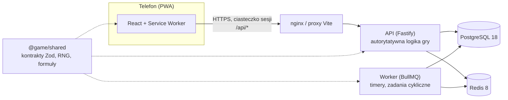

# Zapomniany Brzeg

Mobilna gra webowa (PWA) typu PvE RPG w mrocznym, lovecraftowskim klimacie, wzorowana mechanicznie na Isekai Guardians. Projekt gry opisuje dokument projektowy (GDD).

To repozytorium zawiera **fundament techniczny**: monorepo, klienta PWA, autorytatywny serwer API, bazę z migracjami, kolejkę zadań, logowanie i szkielet interfejsu. Systemów gry (walka, zlecenia, Seanse…) jeszcze tu nie ma — powstaną etapami według GDD.

## Stos technologiczny i uzasadnienie

| Warstwa          | Wybór                                                                                  | Dlaczego                                                                                                                                                                                                                                                                                          |
| ---------------- | -------------------------------------------------------------------------------------- | ------------------------------------------------------------------------------------------------------------------------------------------------------------------------------------------------------------------------------------------------------------------------------------------------- |
| Monorepo         | **pnpm 12** (workspaces) + **Turborepo 2.11**                                          | Ścisła izolacja zależności (brak „fantomowych” importów), szybkie instalacje, cache zadań i graf zależności (`^build`), dzięki któremu pakiet współdzielony buduje się przed aplikacjami.                                                                                                         |
| Język            | **TypeScript 6.0** (strict, `exactOptionalPropertyTypes`, `noUncheckedIndexedAccess`)  | Jeden język i jedne typy od bazy po UI. TypeScript 7 (natywny kompilator) nie jest jeszcze wspierany przez typescript-eslint (wymaga `<6.1`), więc przejdziemy na niego, gdy pojawi się wsparcie.                                                                                                 |
| Klient           | **React 19** + **Vite 8** + **vite-plugin-pwa 2** (Workbox) + **Tailwind CSS 4**       | Gra to aplikacja za logowaniem — SEO i SSR nic nie dają, więc Next.js byłby zbędnym narzutem. Vite daje najszybszy build i najprostszą PWA (manifest, service worker, offline dla zasobów statycznych), a wynik to statyczne pliki do CDN.                                                        |
| Routing i dane   | **React Router 8** + **TanStack Query 5**                                              | Sprawdzony routing deklaratywny; TanStack Query zarządza stanem serwera (cache, ponawianie, odświeżanie po powrocie do karty), co pasuje do gry asynchronicznej.                                                                                                                                  |
| API              | **Fastify 5** + **Zod 4**                                                              | Szybki i lekki, bez ceremonii NestJS. Gotowe pluginy (cookie, helmet, rate-limit) i `inject()` do testów bez sieci. Zamiast tRPC wybraliśmy zwykłe REST + współdzielone schematy Zod: typy są end-to-end tak samo, a API zostaje standardowym HTTP (logi, cache, curl, przyszli klienci natywni). |
| Baza             | **PostgreSQL 18** + **Drizzle ORM 0.45** + drizzle-kit                                 | Transakcje, ograniczenia `CHECK`/`UNIQUE` i blokady wierszy są kluczowe dla księgi walut i anty-cheatu (GDD rozdz. 9). Drizzle jest „SQL-first”, bez silnika binarnego (w odróżnieniu od Prismy), a migracje to czytelne pliki SQL w repo. PostgreSQL 18 daje natywne `uuidv7()`.                 |
| Timery i kolejki | **Redis 8** + **BullMQ 6** (osobny proces workera)                                     | GDD opiera grę na timerach (`TimedActivity`) i zadaniach cyklicznych (rozdz. 9.3). Redis obsługuje też limit prób logowania.                                                                                                                                                                      |
| Czas rzeczywisty | **WebSocket — celowo jeszcze nie**                                                     | Rozgrywka jest asynchroniczna (timery + Web Push). Gdy dojdą czat, loże i rajdy na żywo: `@fastify/websocket` + Redis pub/sub w procesie API.                                                                                                                                                     |
| Uwierzytelnianie | E-mail + hasło, **Argon2id**, sesje w PostgreSQL, ciasteczko `httpOnly` `SameSite=Lax` | Sesje nieprzezroczyste (w bazie tylko skrót SHA-256 tokenu) można natychmiast unieważnić (wylogowanie, ban) — w przeciwieństwie do JWT. API i PWA dzielą origin (proxy), więc nie potrzeba CORS.                                                                                                  |
| Testy            | **Vitest 5**, Testing Library, **Playwright 1.64**                                     | Jednostkowe i integracyjne (prawdziwy PostgreSQL i Redis), E2E na emulowanych telefonach: Pixel 7 (Chromium) i iPhone 14 (WebKit; ekran 390×844, jak w definicji ukończenia GDD).                                                                                                                 |
| Jakość           | **ESLint 10** (typescript-eslint `strictTypeChecked`, react-hooks), **Prettier 3**, CI | Reguły z informacją o typach łapią błędy asynchroniczne i niebezpieczne `any`. GitHub Actions uruchamia wszystko przy każdym PR.                                                                                                                                                                  |
| Uruchomienie     | **Docker Compose**, Node.js **24 LTS**                                                 | Jedno polecenie stawia bazę i Redisa do developmentu albo pełny stos (API, worker, migracje, PWA za nginx).                                                                                                                                                                                       |

## Architektura



### Autorytatywny serwer

Zgodnie z GDD (rozdz. 9) **klient jest tylko oknem**:

- Klient wysyła **intencje** (np. „rozpocznij zlecenie”), nigdy wyników. Nagrody, walka, losowania i poziomy zmieniają się wyłącznie na serwerze, w transakcjach bazy.
- **Czas** pochodzi z zegara serwera (`Clock` w API, endpoint `GET /api/v1/time`). Logika nie woła `new Date()` bezpośrednio, więc testy używają wirtualnego zegara.
- **Losowanie**: serwer wybiera ziarno (CSPRNG) i rozstrzyga rzut deterministycznym generatorem z `@game/shared` (sfc32, wyłącznie arytmetyka 32-bitowa). Zapisane ziarno pozwala odtworzyć walkę lub łup (powtórki, audyt).
- **Formuły** (np. krzywa doświadczenia z GDD 10.2) są w `@game/shared` jako czyste funkcje. Serwer liczy nimi stan gry, klient — tylko podgląd (np. pasek XP). Wartości są zablokowane **wektorami referencyjnymi** (`GOLDEN_VECTORS`), które sprawdzają testy pakietu, serwera i klienta (przez potok Vite). Wersję balansu oznacza `BALANCE_VERSION`.

## Struktura repozytorium

```
apps/
  api/          serwer Fastify, schemat bazy (Drizzle), migracje SQL (drizzle/), worker BullMQ
  web/          klient PWA (React, Vite, Tailwind), ikony, konfiguracja nginx
packages/
  shared/       kontrakty API (Zod), deterministyczny RNG, arytmetyka stałoprzecinkowa, krzywa XP
e2e/            testy Playwright na widoku mobilnym
docker-compose.yml, turbo.json, eslint.config.js, .github/workflows/ci.yml
```

## Szybki start

Wymagania: **Node.js 24 LTS** (minimum 22.22), **corepack** (dostarcza pnpm w wersji z `package.json`) i **Docker**.

```bash
corepack enable
pnpm install
cp .env.example .env
docker compose up -d                  # PostgreSQL 18 + Redis 8
pnpm db:migrate                       # migracje bazy
pnpm dev                              # API na :3000, PWA na :5173 (proxy /api → API)
pnpm --filter @game/api dev:worker    # opcjonalnie: worker kolejki timerów
```

Otwórz <http://localhost:5173> (najlepiej w trybie urządzenia mobilnego w DevTools) i załóż konto.

Pełny stos w kontenerach (migracje, API, worker, PWA za nginx):

```bash
docker compose --profile app up --build   # → http://localhost:8080
```

## Polecenia

| Polecenie                       | Co robi                                                      |
| ------------------------------- | ------------------------------------------------------------ |
| `pnpm dev`                      | tryb deweloperski wszystkich pakietów (watch)                |
| `pnpm build`                    | build produkcyjny (shared → api, web)                        |
| `pnpm lint`                     | ESLint z regułami typowanymi                                 |
| `pnpm typecheck`                | kontrola typów wszystkich pakietów                           |
| `pnpm format` / `:check`        | Prettier                                                     |
| `pnpm test`                     | testy jednostkowe (shared, api, web)                         |
| `pnpm test:integration`         | testy integracyjne API na prawdziwym PostgreSQL i Redisie    |
| `pnpm test:e2e`                 | testy E2E Playwright (buduje i uruchamia API oraz PWA)       |
| `pnpm db:generate`              | generuje migrację SQL ze zmian w `apps/api/src/db/schema.ts` |
| `pnpm db:migrate`               | stosuje migracje                                             |
| `pnpm --filter @game/web icons` | odtwarza ikony PWA z `apps/web/public/favicon.svg`           |

## Testy

- **Jednostkowe** (`pnpm test`) — nie wymagają infrastruktury.
- **Integracyjne** (`pnpm test:integration`) — wymagają `docker compose up -d`. Używają osobnej bazy `game_test` (tworzonej automatycznie) i bazy Redis nr 1, więc nie dotykają danych deweloperskich. Adresy można nadpisać zmiennymi `TEST_DATABASE_URL` i `TEST_REDIS_URL`.
- **E2E** (`pnpm test:e2e`) — wymagają PostgreSQL i Redisa. Za pierwszym razem zainstaluj przeglądarki: `pnpm --filter @game/e2e exec playwright install chromium webkit`. Playwright uruchamia zbudowane API (port 3100, z migracjami) i `vite preview` (port 4173). Test „zrzut ekranu Domu” zapisuje zrzut w `e2e/test-results/`.

## API (v1)

| Metoda i ścieżka             | Opis                                    |
| ---------------------------- | --------------------------------------- |
| `GET /api/health`            | stan bazy i Redisa (200 albo 503)       |
| `GET /api/v1/time`           | czas serwera                            |
| `POST /api/v1/auth/register` | konto + postać (jedna na konto) + sesja |
| `POST /api/v1/auth/login`    | logowanie (limit prób na IP)            |
| `POST /api/v1/auth/logout`   | unieważnienie sesji                     |
| `GET /api/v1/me`             | konto i postać zalogowanego gracza      |

Błędy mają postać `{ "error": { "code": "…", "message": "…" } }`; kody są w `ERROR_CODES` w `@game/shared`.

## Model danych

Zgodnie z GDD (rozdz. 8): `accounts` (konto), `characters` (dokładnie jedna postać na konto, unikalne imię bez względu na wielkość liter) i `sessions`. Zmiany schematu: edytuj `apps/api/src/db/schema.ts`, uruchom `pnpm db:generate` i dołącz wygenerowany plik SQL do commita.

## Dopasowanie do GDD i kolejne kroki

Fundament jest już zgodny z GDD w zakresie: modelu konto–postać 1:1, zegara serwera, kolejki timerów z workerem, deterministycznego RNG, krzywej doświadczenia z rozdz. 10.2 (tabela GDD jest wektorem referencyjnym w testach), pasku gracza (Życie, Wigor, Znój, Poczytalność, Srebro, poziom) i dolnej nawigacji (Dom, Miasto, Mrok, Postać, Wspólnota) z Domem jako pulpitem timerów.

Do domknięcia w **Etapie 0** GDD:

1. `ResourceState` z leniwą regeneracją liczoną z czasu serwera (+ test z wirtualnym zegarem).
2. `WalletEntry` — księga walut z kluczem idempotencji.
3. `TimedActivity` + scheduler (zadania cykliczne BullMQ) i rozstrzyganie timerów przez worker.
4. Idempotencja żądań mutujących (`requestId`) i `AuditLog`.
5. Dane statyczne (przedmioty, wrogowie, zlecenia) jako wersjonowane pliki w repo.
6. Szkielet Web Push.

## Konwencje

- Interfejs, komentarze, commity i dokumentacja po polsku; identyfikatory w kodzie po angielsku.
- Kontrakt najpierw: każdy endpoint ma schemat Zod w `@game/shared`, używany po obu stronach.
- Kolory i fonty interfejsu są w `apps/web/src/styles.css` (motyw Tailwind): czerń atramentu, kość, mosiądz, grynszpan, a dla zasobów — czerwień, bursztyn, szarość i zimny błękit.
